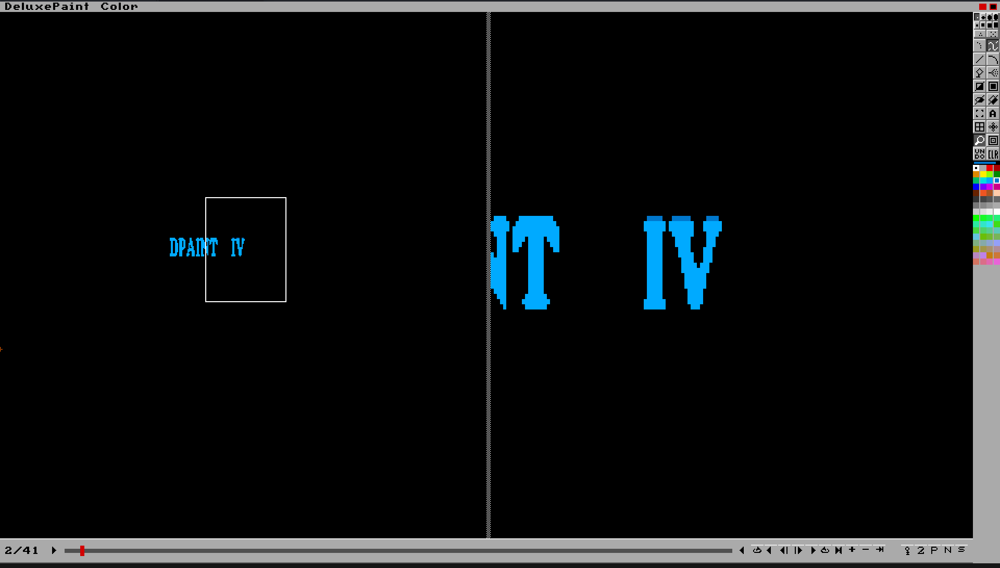

# Deluxe Paint IV for Linux



A native C and SDL2 recreation of Deluxe Paint IV. The menu names match
the original. The UI font, the other built-in faces, the toolbox
bitplanes, and the default palette are compiled into the source, so the
program paints text with no Amiga disk present. The page is whatever
space is left after the menu bar, tool column, and palette, so a large
monitor gets a larger page than 320x200. Screen Format still offers the
four original sizes.

Original Deluxe Paint IV is copyright 1985-1991 Electronic Arts. This
tree does not ship the ADF, the program, kickstarts, or the unpacked
disk. Those stay in `amiga_original/` and `kickstart/` (gitignored) for
FS-UAE only.

## Build and run

Needs gcc and SDL2 (`pkg-config sdl2`).

```
make
./dpaint
make smoke
```

`make run` is the same launch. `make smoke` does not open a window. It
draws strokes, a line, a filled rectangle, and a fill; adds a frame and
changes it; writes an ILBM (PackBits and uncompressed) and a brush with
GRAB; writes a compressed ANIM and an expanded ANIM; writes a PRSP and
a 1-plane stencil; reads each back and compares pixels or bytes; and
writes `ui.ppm` of the chrome. The temp directory is printed at the end.

The window title is Deluxe Paint IV. A directory argument still loads
DiskFont files and a DPaint hunk from that path. With no argument the
built-in faces, icons, and palette are used. Picking a font file still
goes through the DiskFont loader.

## What this build does

- Menu bar, right tool column, bottom palette and status, integer scale
- Tools: dotted freehand, continuous draw, line, curve, fill, rectangle,
  filled rectangle, circle, ellipse, airbrush, text, brush pickup and
  stamp, undo, clear
- 32/64-color palette, color mixer (RGB and HSV), palette arranger,
  and multi-range cycle editor (`Ranges..`)
- Modes: Matte, Color, Replc, Smear, Shade, Blend, Cycle, Smooth, Mix,
  and HBrite
- Brush operations: Restore, Spare (`Brush->Spare`, `Brush<->Spare`,
  `Metamorph..`), Size (`Stretch`, `Halve`, `Double`, `Double Horiz`,
  `Double Vert`), Flip (`Horiz`, `Vert`), Edge (`Outline`, `Trim`),
  Rotate (`90 Degrees`, `Any Angle`, `Shear`), Bend (`Horiz`, `Vert`),
  and Handle (`Center`, `Corner`, `Place`)
- Effects: Stencil, LightTable (`On/Off`, `Merge`, `Dim`, `Two Back`,
  `Previous`, `Next`, `Spare`), Background (`Fix`, `Free`, `Lock FG`),
  AntiAlias (`None`, `Low`, `High`), Process (`On/Off`, `Tint`, `Hue`,
  `Value`), Translucency (`On/Off`, `Settings..`), and 3D Perspective
  (`Do`, `FillScreen`, `Reset`, `Center`, `Settings..`)
- Print Picture requester (`B & W`, `Grey`, `Color`, positive/negative,
  normal/sideways, `%Wide`/`%High`)
- Spare page: swap, copy, merge in front, merge in back
- Frames: add, copy, delete, next, previous, go to, play, play once,
  ping-pong, frame rate, 3D `Move..` dialog and `MOVE` templates.
  AnimBrush pickup, settings, and stamp across frames
- Screen formats Lo-Res 320x200, Med-Res 640x200, Interlace 320x400,
  Hi-Res 640x400, HAM 320x200, and a larger default page
- About credits: Daniel Silva, Lee Taran, and Steve Shaw

## File formats that round-trip here

Tested by `make smoke` on files this program writes:

- ILBM pictures: FORM/ILBM, BMHD, CMAP, CAMG, CRNG, DRNG, BODY.
  Compression 0 and PackBits (1), including HAM6 (`CAMG 0x800`).
- ILBM brushes: the same, plus GRAB
- ANIM: first frame is an ILBM. Compressed frames are ANHD operation 5
  and DLTA (byte columns). Expanded frames are a full BODY each. DPAN
  carries the frame count and rate.
- PRSP: FORM/PRSP with a 110-byte DPPS chunk for perspective settings,
  or a 24-byte MOVE chunk for animation move templates.
- Stencil: a 1-plane ILBM. No stencil chunk id was found in the program,
  so this is the container used here, not a verified original stencil.

Notes on the Amiga binary are in `notes/RE.md`.
